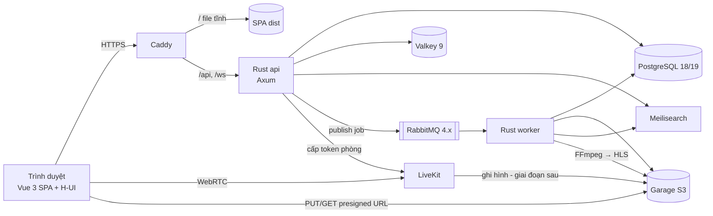
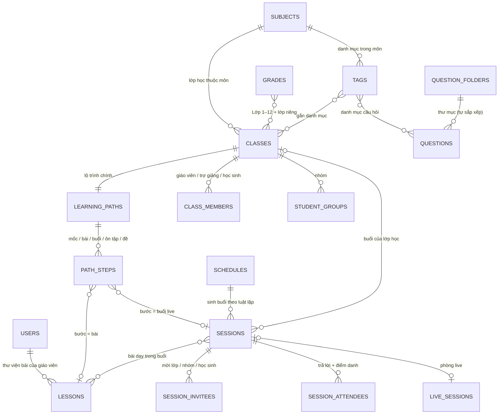
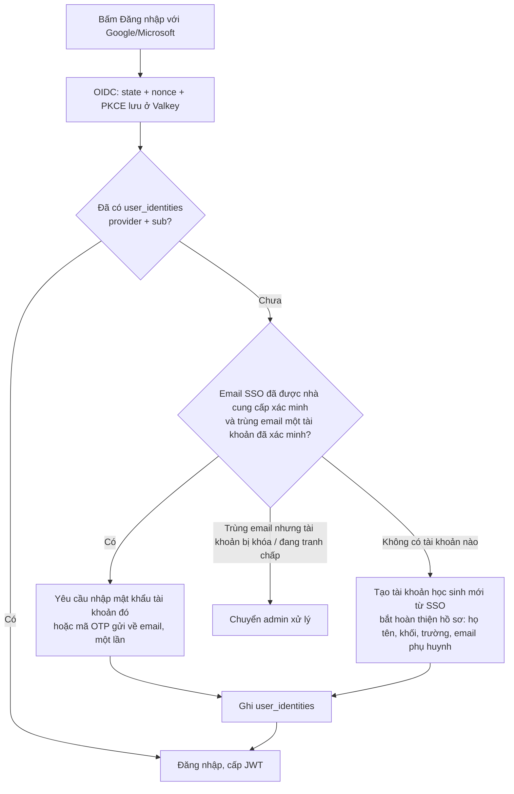

# Smart-Learning-Space — Phân tích kiến trúc

> **Trạng thái:** v0.4 (2026-11-05) — kiến trúc đã đủ để bắt đầu code theo module (`docs/implementation-plan.md`); các câu còn mở ở mục 8 không chặn module đầu.
> v0.3: đổi tên gọi nội dung (bỏ "chủ đề"), lộ trình sửa được, lên lịch kiểu Meet, import MathType/PDF thành ảnh, bảng thông minh có hình khối và đồ thị.
> v0.4: môn học + lớp học là chính, bài và buổi nằm trong lộ trình (bỏ tầng "khóa học"); lớp 1–12 + lớp riêng; danh mục là nhãn trong môn; tương tác live giơ tay → popup bảng.
> Yêu cầu nghiệp vụ: `requirements.md`. Sau khi chốt → viết đặc tả chi tiết (schema DB, danh sách API, wireframe) → mới bắt đầu code.

---

## 1. Đánh giá tech stack

| Thành phần | Đề xuất ban đầu | Đánh giá | Khuyến nghị |
|---|---|---|---|
| Database | PostgreSQL 16 | Phù hợp | **ĐÃ CHỐT: bản ổn định mới nhất** (18 → 19, xem bảng phiên bản bên dưới). Bật extension `pg_trgm`, `unaccent` (tìm tiếng Việt không dấu); `pgvector` để dành cho AI sau này → không cần vector DB riêng. |
| Cache / Session / Pub-Sub | Redis 7 | Phù hợp | **ĐÃ CHỐT: Valkey**, dùng nhánh mới nhất 9.x (bản fork của Redis, giấy phép BSD, dùng y hệt, client Rust giữ nguyên). Dùng cho: cache, danh sách refresh token bị thu hồi, rate limit, Pub/Sub để phát WebSocket giữa nhiều instance, presence (ai đang online), bảng xếp hạng (sorted set). |
| Message Queue | RabbitMQ 3 | Phù hợp | **ĐÃ CHỐT: RabbitMQ 4.x mới nhất** (nhánh 3.x đã hết hỗ trợ), dùng *quorum queue*. Việc nền: chuyển mã video sang HLS, chấm bài, gửi email/thông báo, đồng bộ Meilisearch, tổng hợp thống kê tiến độ. |
| File storage | MinIO | **Nên đổi** | Từ 2025, MinIO bản cộng đồng đã bỏ giao diện quản trị, ngừng phát hành binary/Docker image và chuyển sang chế độ chỉ bảo trì (nên kiểm tra lại trước khi chốt). **ĐÃ CHỐT: Garage** (viết bằng Rust, nhẹ, tương thích S3), tự host trên máy của mình (xem mục "Garage chạy ở đâu" bên dưới). Code chỉ gọi **API S3**, nên sau này có thể chuyển sang Cloudflare R2 hoặc AWS S3 mà không sửa code. |
| Reverse proxy | Traefik 3 / Caddy | **ĐÃ CHỐT: Caddy** | Mô hình 1 VPS với ít service: Caddy tự cấp HTTPS, cấu hình ngắn, phục vụ luôn file tĩnh của SPA, hỗ trợ WebSocket, tốn khoảng 30 MB RAM. Traefik chỉ đáng dùng khi có nhiều service tự phát hiện qua label hoặc chạy Kubernetes. Xác thực và rate limit đặt trong middleware Rust, không đặt ở proxy. |
| Search | Meilisearch | Phù hợp | Tìm khóa học, bài học, câu hỏi; có chịu lỗi gõ sai. Dữ liệu được worker đồng bộ qua hàng đợi. |
| Container | Docker | Phù hợp | Docker Compose cho dev và production 1 máy. Image Rust build nhiều tầng, kết quả là image distroless khoảng 20–30 MB. |

### Phiên bản (nguyên tắc: bản ổn định mới nhất, không dùng beta/RC)

Tra cứu ngày 2026-11-05. Số patch chính xác sẽ được kiểm tra lại và **ghim cố định trong `docker-compose.yml`** ở bước G1 (không dùng tag `latest`).

| Service | Phiên bản dùng | Ghi chú |
|---|---|---|
| PostgreSQL | **18.x** khi bắt đầu dev → **19.x** — **[G1] đang ghim `postgres:18.6-alpine`** | PostgreSQL 19 mới ở bản RC, dự kiến phát hành chính thức ngày 19/11/2026. Production còn cách vài tháng, và khi đó dev chưa có dữ liệu thật nên chuyển sang 19 chỉ cần đổi tag image. Sẽ chuyển ngay khi 19 phát hành chính thức. |
| Valkey | **9.1.x** — **[G1] ghim `valkey/valkey:9.1.3-alpine`** | Thay cho Redis; client Rust dùng như với Redis. |
| RabbitMQ | ~~4.3.x~~ **4.4.x** — **[G1] ghim `rabbitmq:4.4.0-management-alpine`** | Lúc dựng G1 (2026-11-05) nhánh mới nhất đã là 4.4. ~~Nhánh mới nhất.~~ Theo trang chính thức, bản cộng đồng của 4.3 hết hỗ trợ ngày 30/11/2026, nên nếu nhánh 4.x tiếp theo ra trước khi lên production thì nâng lên. |
| Garage | **2.x** (2.3 trở lên) | |
| Meilisearch | **1.x mới nhất** | Chỉ bản mới nhất được vá lỗi, nên cần cập nhật thường xuyên. |
| Caddy | **2.11.x** | |
| LiveKit server | **1.13.x** trở lên | |
| Rust | stable mới nhất (edition 2024) — **[G1] 1.99.1** | Axum 0.8, SQLx 0.9, jsonwebtoken 11, lapin 4, redis 1.8, lettre 0.11 |
| Node.js | LTS mới nhất — **[G1] 24.x** | Chỉ dùng để build Vue, production không chạy Node. Frontend G1: Vue 3.5, Vue Router 5, Pinia 4, Vite 8, Vitest 5 |
| Mailpit (dev) | **[G1] `axllent/mailpit:v1.33.0`** | Bắt email khi dev |

### Garage chạy ở đâu?

Đúng, Garage **chạy trên máy của mình**: là một container trong `docker-compose`, file lưu trong volume trên ổ đĩa của máy đó. Không phải dịch vụ cloud, không mất phí theo dung lượng.

- **Dev:** chạy trên máy bạn cùng các service khác.
- **Production:** chạy trên VPS. Video chiếm nhiều dung lượng nhất, nên cần tính ổ đĩa theo tổng số giờ video bài giảng; ước lượng sơ bộ khoảng 0.5–1.5 GB cho mỗi giờ video sau khi chuyển sang HLS nhiều độ phân giải.
- Chạy 1 node thì dữ liệu chỉ có một bản, **bắt buộc phải sao lưu** (ví dụ dùng `rclone` đồng bộ định kỳ sang ổ khác hoặc sang một kho lưu trữ khác). Garage cho phép thêm node ở máy khác sau này để có bản sao.
- Trình duyệt upload thẳng lên Garage bằng presigned URL. Caddy chuyển tiếp đường dẫn `/files/*` vào Garage, nhờ vậy dùng chung domain và chứng chỉ HTTPS.

### Cần bổ sung

| Thêm | Lý do |
|---|---|
| **Backend Rust** — Axum 0.8 + Tokio + SQLx | Tốn rất ít RAM (khoảng 20–50 MB mỗi instance), an toàn bộ nhớ, SQLx kiểm tra câu SQL ngay lúc compile. |
| **LiveKit** (WebRTC SFU, tự host) | Cho cổng dạy trực tiếp: video, âm thanh, chia sẻ màn hình. Đã kèm sẵn TURN. Backend Rust chỉ cấp token phòng (crate `livekit-api`). |
| **FFmpeg** (trong worker) | Chuyển video bài giảng sang HLS nhiều độ phân giải. |
| **Mailpit** (chỉ dùng khi dev) | Bắt email gửi đi khi test. |
| **Sao lưu** — `pg_dump` theo lịch, sau này dùng WAL-G | Bắt buộc phải có trước khi chạy thật. |
| **Log** — `tracing`, xuất JSON | Giai đoạn sau mới thêm Grafana/Loki nếu cần. |

### Frontend: Nuxt 4 hay Vue 3?

Tốc độ chạy trên trình duyệt **gần như bằng nhau**, vì Nuxt dựng trên chính Vue 3. Khác biệt nằm ở phía server:

- **Nuxt (SSR)** cần thêm một tiến trình Node trên server (khoảng 100–200 MB RAM). Đổi lại, trang công khai được SEO tốt.
- **Vue 3 SPA (Vite)** build ra file tĩnh, Caddy phục vụ trực tiếp, **không cần Node ở production**. Dev nhanh và đơn giản hơn.

→ **ĐÃ CHỐT: Vue 3 + Vite + Vue Router + Pinia, viết JavaScript**, vì phần lớn hệ thống nằm sau đăng nhập, và cách này khớp với mục tiêu tiết kiệm RAM.

**[UPDATED 2026-11-05]** Vì đây là nền tảng mở, trang khóa học và trang giáo viên công khai cần SEO. Vẫn giữ Vue SPA và **không cần Nuxt**:
- Caddy chuyển các đường dẫn công khai (`/khoa-hoc/:slug`, `/giao-vien/:slug`) cho backend Rust.
- Backend trả về `index.html` đã chèn sẵn `<title>`, mô tả, thẻ Open Graph (để chia sẻ lên Facebook/Zalo hiện ảnh và tiêu đề) và dữ liệu có cấu trúc JSON-LD `Course`.
- Backend sinh `sitemap.xml`. Google vẫn tự chạy JS để đọc phần nội dung còn lại.
Dùng TypeScript hay không không ảnh hưởng tốc độ chạy. Bỏ TS thì vẫn có thể ghi kiểu bằng JSDoc ở các chỗ quan trọng (store, API client).

---

## 2. Kiến trúc tổng thể

**Modular monolith**: một binary `api` (HTTP + WebSocket) và một binary `worker` (xử lý hàng đợi), dùng chung crate `core`.
Chưa tách microservice. Ranh giới giữa các module được giữ rõ để sau này tách ra khi cần.



### Luồng một request (MVC + Service + Repository + Middleware)

```
Request
  → Caddy
  → Router (routes/)
  → Middleware (tower layers, chạy theo thứ tự):
       request_id → trace/log → CORS → timeout → giới hạn body
       → rate_limit (Valkey) → auth (JWT, gắn CurrentUser) → guard theo vai trò/quyền
  → Controller  (controllers/) — đọc và validate DTO, gọi service, trả JSON
  → Service     (services/)    — nghiệp vụ, transaction, kiểm tra quyền sở hữu, phát sự kiện
  → Repository  (repositories/)— chỉ chứa SQL (SQLx), không chứa nghiệp vụ
  → PostgreSQL
Response ← DTO response (đóng vai "View" của MVC trong một API JSON) ← AppError → mã HTTP + JSON lỗi thống nhất
```

### Model (Entity) ↔ DTO ↔ JSON

Có đủ ba tầng dữ liệu; mỗi tầng một struct riêng, **không dùng chung một struct từ DB ra thẳng JSON**:

| Tầng | Struct | Vai trò |
|---|---|---|
| **Entity / Model** | `model.rs` — `#[derive(sqlx::FromRow)]` | Ánh xạ 1-1 với một dòng trong bảng, kể cả cột nhạy cảm (`password_hash`, `deleted_at`). Chỉ repository và service dùng. |
| **Request DTO** | `dto.rs` — `#[derive(Deserialize, Validate)]` | JSON gửi lên → struct đã validate. Controller nhận, service dùng. |
| **Response DTO** | `dto.rs` — `#[derive(Serialize)]` | Struct trả về client: chỉ có các trường được phép lộ ra, đổi tên theo `camelCase`. Đây là "View" của MVC. |

Chiều trả về: DB row → `sqlx::FromRow` → **Entity** → `impl From<Entity> for ResponseDto` → `serde` → JSON.

```rust
// modules/users/model.rs — Entity
#[derive(sqlx::FromRow)]
pub struct User {
    pub id: Uuid,
    pub username: String,
    pub email: String,
    pub password_hash: Option<String>, // không bao giờ ra ngoài
    pub role: UserRole,
    pub created_at: DateTime<Utc>,
}

// modules/users/dto.rs — Response DTO
#[derive(Serialize)]
#[serde(rename_all = "camelCase")]
pub struct UserResponse {
    pub id: Uuid,
    pub username: String,
    pub email: String,
    pub role: UserRole,
    pub created_at: DateTime<Utc>,
}

impl From<User> for UserResponse {
    fn from(u: User) -> Self {
        Self { id: u.id, username: u.username, email: u.email, role: u.role, created_at: u.created_at }
    }
}

// controller: Json(UserResponse::from(user))  — hoặc  users.into_iter().map(Into::into).collect()
```

Với màn hình cần dữ liệu từ nhiều bảng (ví dụ danh sách lớp kèm số học sinh), repository trả về một struct **read model** (`#[derive(FromRow)]`, chỉ có các cột cần dùng) rồi đổi sang DTO, không ghép nhiều entity trong Rust.

### Có nên chia thành nhiều service (microservice)?

**Chưa nên.** Khuyến nghị **modular monolith**: một binary nhưng chia module theo nghiệp vụ, mỗi module có đủ controller / service / repository / model / dto riêng.

- Một người phát triển: microservice nhân số lần deploy, log, cấu hình và lỗi mạng lên nhiều lần.
- Nhiều nghiệp vụ cần transaction chung (nộp bài → chấm điểm → cập nhật tiến độ). Tách service thì phải dùng saga/outbox, rất phức tạp.
- Mỗi service thêm một tiến trình và một kết nối DB pool, đi ngược mục tiêu tiết kiệm RAM.

Những thứ **đã được tách** vì có lý do rõ ràng: `worker` (việc nặng, chạy nền), LiveKit (media), Meilisearch.
Sau này sẽ tách thêm khi có nhu cầu thật: service AI viết bằng Python, hoặc gateway realtime khi số kết nối WebSocket lớn.

Quy tắc để sau này tách dễ: module A **không** gọi repository của module B, chỉ gọi service public của B. Mỗi module chỉ ghi vào các bảng của chính nó.

### Cấu trúc thư mục dự kiến

```
Smart-Learning-Space/
├── backend/                     # Cargo workspace
│   ├── Cargo.toml
│   ├── migrations/              # SQLx migrations
│   └── crates/
│       ├── core/                # lib dùng chung cho api và worker
│       │   └── src/
│       │       ├── config.rs, db.rs, errors.rs, events.rs
│       │       └── modules/     # mỗi nghiệp vụ một thư mục
│       │           ├── users/   {model.rs, dto.rs, repository.rs, service.rs}
│       │           ├── classes/ {model.rs, dto.rs, repository.rs, service.rs}
│       │           └── catalog/, lessons/, enrollments/, questions/, imports/, exams/, paths/,
│       │               schedules/, progress/, live/, boards/, discussions/, notifications/, files/
│       ├── api/                 # binary HTTP + WebSocket
│       │   └── src/
│       │       ├── main.rs, app.rs (AppState, ghép router)
│       │       ├── controllers/ {users.rs, classes.rs, ...}  # mỗi file tự khai báo routes()
│       │       ├── middleware/  {request_id.rs, auth.rs, role_guard.rs, rate_limit.rs}
│       │       └── realtime/    # WebSocket hub + Valkey Pub/Sub
│       └── worker/              # binary RabbitMQ consumer
│           └── src/{main.rs, jobs/}
├── frontend/                    # Vue 3 + Vite + H-UI
│   └── src/{api/, stores/, router/, layouts/, pages/{auth,student,teacher,admin,live}/, components/}
├── deploy/
│   ├── docker-compose.yml       # postgres, valkey, rabbitmq, garage, meilisearch, livekit, caddy, api, worker
│   ├── docker-compose.dev.yml   # thêm mailpit, mở cổng debug
│   └── Caddyfile
└── docs/                        # đặc tả chi tiết (sau khi chốt kiến trúc)
```

### Crate Rust chính

| Việc | Crate |
|---|---|
| Web, middleware | `axum` 0.8, `tower`, `tower-http` (cors, trace, compression, request-id, timeout, limit) |
| DB | `sqlx` (postgres, migrate, uuid, chrono) |
| Cấu hình, lỗi | `dotenvy`/`config`, `thiserror`, `anyhow` (chỉ dùng trong main) |
| Xác thực | `argon2` (băm mật khẩu), `jsonwebtoken` (access token 15 phút; refresh token 30 ngày, có xoay vòng) |
| Validate | `validator` |
| Valkey / RabbitMQ / S3 / Search | `fred` hoặc `deadpool-redis`, `lapin`, `aws-sdk-s3`, `meilisearch-sdk` |
| Tài liệu API | `utoipa` + Swagger UI |
| Log | `tracing`, `tracing-subscriber` (JSON) |
| Live | `livekit-api` (cấp token phòng) |
| Lịch & email *(v0.3)* | `rrule` (luật lặp), `icalendar` (file `.ics`), `lettre` (SMTP) |
| Import *(v0.3)* | `calamine` (Excel), `zip` + `quick-xml` (Word), `pdfium-render` (PDF). Công cụ ngoài chạy trong container worker: LibreOffice headless (WMF/EMF → SVG), Tesseract (OCR, tùy chọn), FFmpeg (video). Vì vậy image `worker` lớn hơn nhiều so với image `api` (vẫn khoảng 20–30 MB) |

---

## 3. Các module nghiệp vụ (MVP)

| Module | Nội dung chính | Bảng dữ liệu (dự kiến) |
|---|---|---|
| **Auth & Users** | **[UPDATED]** Học sinh tự đăng ký (xác minh email) hoặc đăng nhập SSO; giáo viên đăng ký kèm hồ sơ và chờ admin duyệt; giới hạn số thiết bị đăng nhập cùng lúc; vai trò: admin / giáo viên / học sinh, cộng thêm **khách** (chỉ dùng cho buổi live mở) | `users`, `student_profiles` (trường, tỉnh, khối), `teacher_profiles`, `user_identities`, `refresh_tokens`, `user_devices` |
| **Thông tin phụ huynh** | Không phải tài khoản đăng nhập, chỉ là thông tin liên hệ gắn với học sinh: phụ huynh xác nhận đồng ý qua email, nhận báo cáo tiến độ qua email | `student_guardians`, `guardian_consents`, `report_deliveries` |
| **Master data** **[UPDATED v0.4]** | **Môn học**; **Lớp** 1–12 + lớp riêng tự thêm; **Danh mục** = nhãn trong một môn; mức độ câu hỏi; giáo viên được duyệt dạy những môn nào. Admin gộp các mục trùng do giáo viên tự thêm. ~~Cây chủ đề chung~~, ~~Lớp 6–12~~ | `subjects`, `grades`, `tags` (thuộc `subject_id`), `teacher_subjects` ~~`topics`, `categories`~~ |
| **Thư viện bài** ~~Khóa học~~ **[UPDATED v0.4]** | Bài của giáo viên (video, tài liệu, văn bản, bảng đã soạn); gắn môn / lớp / danh mục; **bản nháp → xuất bản**, giữ lịch sử phiên bản; một bài dùng được ở nhiều lớp học. ~~Tầng khóa học (chương / phần → bài)~~ đã bỏ | `lessons`, `lesson_tags`, `lesson_revisions`, `files` ~~`courses`, `course_sections`~~ |
| **Lớp học** **[UPDATED v0.4 — là trục chính]** | Thuộc 1 môn, 1 hoặc nhiều lớp, gắn danh mục; giáo viên + trợ giảng + học sinh; public / unlisted / private; **có buổi live hoặc tự học** (không lịch); nội dung chính là **lộ trình**; nhóm học sinh; bảng tin; bài tập về nhà; chừa chỗ cho học phí; tạo lớp học mới từ lớp học cũ | `classes`, `class_tags`, `class_members` (`owner` / `assistant` / `student`), `student_groups`, `student_group_members`, `class_posts`, `homeworks`, `homework_submissions` |
| **Lịch & Buổi** *(mới v0.3)* | Lên lịch kiểu Google Meet: tạo buổi vào khung giờ, lặp lại, mời lớp / nhóm / từng học sinh, email kèm `.ics`, trả lời tham gia, nhắc lịch, điểm danh | `schedules` (luật lặp), `sessions` (từng buổi), `session_invitees`, `session_attendees` |
| **Ghi danh** | Ghi danh vào lớp học ~~khóa học hoặc lớp~~: tự do / giáo viên duyệt / mã mời / (sau này) trả phí | `enrollments` (trạng thái: `pending` / `active` / `rejected` / `left`) |
| **Ngân hàng câu hỏi & Import** | Câu hỏi gắn môn / lớp / **danh mục** (v0.4) / mức độ; **thư mục câu hỏi** chỉ để giáo viên tự sắp xếp; có phiên bản để sửa đáp án và chấm lại; import Excel → Word → PDF qua bước xem trước | `questions`, `question_versions`, `question_options`, `question_folders`, `question_media`, `import_jobs`, `import_items` |
| **Đề & Ôn tập** | Đề cố định hoặc rút theo **ma trận** (đã chốt); trộn câu và đáp án cho từng lượt làm; chấm theo cấu trúc THPT; chấm lại khi sửa đáp án; ôn tập lặp lại ngắt quãng | `exams`, `exam_sections`, `exam_rules`, `attempts`, `attempt_items`, `attempt_answers`, `review_cards` |
| **Lộ trình** **[UPDATED v0.4]** | **Nội dung của lớp học**: chuỗi bước có thứ tự (mốc / bài / buổi live / bộ ôn tập / đề); kéo thả đổi thứ tự, sửa bất cứ lúc nào; bản nháp → xuất bản; thêm lộ trình riêng cho nhóm / từng học sinh; điều kiện mở khóa | `learning_paths`, `path_steps`, `path_versions`, `path_assignments`, `path_enrollments` |
| **Tiến độ & Báo cáo** | Tiến độ theo bài / khóa / lộ trình; thống kê theo **danh mục** (v0.4); dashboard giáo viên; báo cáo email cho phụ huynh | `lesson_progress`, `step_progress`, `tag_mastery` ~~`topic_mastery`, `folder_mastery`~~, `learning_events` (chia partition theo tháng) |
| **Dạy trực tiếp** | Phòng live của một **buổi** (`sessions`); phòng chờ; LiveKit; điểm danh; chat, giơ tay, bình chọn, quiz nhanh; ghi hình | `live_sessions` (trạng thái phòng, 1-1 với `sessions`), `live_participants`, `live_polls`, `live_poll_votes`, `chat_messages`, `recordings` |
| **Bảng thông minh** | Tài liệu bảng nhiều trang, đồng bộ realtime, phân quyền vẽ, bảng riêng cho từng học sinh | `boards`, `board_pages`, `board_snapshots`, `board_permissions` |
| **Hỏi đáp & Kiểm duyệt** | Hỏi đáp theo bài học; báo cáo vi phạm; nhật ký chat | `lesson_questions`, `lesson_answers`, `reports`, `audit_logs` |
| **Thông báo** | Trong app (qua WebSocket), email (qua worker), nhắc lịch | `notifications`, `reminders` |
| **File** | Upload thẳng lên Garage bằng presigned URL; worker chuyển mã video, chuyển PDF sang ảnh | `files` |
| **Thanh toán** *(sau)* | Học phí theo buổi hoặc theo tháng, trả cho giáo viên tương ứng | `class_prices`, `orders`, `payments`, `payouts` |

### Nền tảng độc lập ~~(một trường)~~ [UPDATED 2026-11-05]

Đây là **nền tảng học tập độc lập**: nhiều giáo viên dạy nhiều môn, học sinh tự đăng ký học. **Không quản lý trường học**; "trường" chỉ là thông tin trong hồ sơ học sinh, dùng để thống kê và cá nhân hóa. Vì vậy không cần multi-tenant.
Quy mô ban đầu vài nghìn học sinh. Ở mức này, một PostgreSQL và một instance `api` là đủ. Khi cần vẫn chạy thêm được instance `api` phía sau Caddy, vì session nằm ở Valkey và WebSocket phát tin qua Pub/Sub.

### Tổ chức nội dung [UPDATED v0.4 — môn học + lớp học là chính, bài và buổi nằm trong lộ trình]

~~v0.2: Môn × Khối × Cây chủ đề → Khóa học → Lớp học.~~ ~~v0.3: Khóa học → Chương / Phần → Bài là một tầng riêng; Lớp 6–12.~~
Theo chốt v0.4: **môn học và lớp học là chính**; bài và buổi chỉ là các bước trong **lộ trình** của lớp học; trong lộ trình có các buổi live được lên lịch.

```
Môn học (Toán, Ngữ văn, Tiếng Anh…)                   ← master data, admin quản lý
 ├─ Danh mục: nhãn trong môn (Đại số, Hình học,         ← master data, admin tạo sẵn,
 │            Ôn thi vào 10, Học sinh giỏi…)               giáo viên tự thêm
 └─ Lớp học "Toán 9 tối T3–T5"  — thuộc 1 môn + Lớp 9, gắn danh mục, của một giáo viên
      ├─ Thành viên: giáo viên, trợ giảng, học sinh, nhóm học sinh
      └─ Lộ trình (nội dung của lớp học, có thứ tự, kéo thả)
           ├─ Mốc "Tuần 1"
           ├─ Bài 1. Căn bậc hai              ← lấy từ thư viện bài của giáo viên
           ├─ Buổi live 1 — 19:30 T3 10/12   ← có lịch, gửi lời mời (mục Lịch)
           ├─ Bộ ôn tập / Đề kiểm tra
           ├─ Mốc "Tuần 2" …
Lớp: Lớp 1 → Lớp 12 + lớp riêng tự thêm ("Ôn thi IELTS", "Đại học")   ← master data
```

| Tên gọi | Là gì | Ai tạo |
|---|---|---|
| **Môn học** | Trục chính của hệ thống | Admin |
| **Lớp** | Lớp 1 → Lớp 12 cố định, cộng **lớp riêng** tự thêm ngoài danh sách | Cố định / giáo viên tự thêm |
| **Danh mục** | **Nhãn trong một môn**; một lớp học, bài, câu hỏi gắn được nhiều nhãn | Admin tạo sẵn, giáo viên tự thêm |
| **Lớp học** | **Trục chính**: một giáo viên + học sinh; thuộc 1 môn, 1 hoặc nhiều lớp; public / unlisted / private; **có buổi live** hoặc **tự học** (chỉ có bài, học lúc nào cũng được) | Giáo viên |
| **Lộ trình** | Nội dung của lớp học: chuỗi bước có thứ tự — mốc, bài, buổi live, bộ ôn tập, đề | Giáo viên |
| **Bài** | Nội dung trong **thư viện bài** của giáo viên; một bài dùng được ở nhiều lớp học | Giáo viên |
| **Buổi** | Buổi live có ngày giờ, là một bước trong lộ trình | Giáo viên / sinh từ lịch lặp |

**Không còn tầng "khóa học" riêng.** Hai việc trước đây khóa học đảm nhận được làm như sau:
- *Khóa tự học* (video quay sẵn, không lịch) = **lớp học kiểu tự học**. Nếu bạn vẫn muốn gọi loại này là "khóa học" trên giao diện thì chỉ cần đổi nhãn hiển thị, dữ liệu không đổi.
- *Dùng lại nội dung cho đợt học sau* = **"Tạo lớp học mới từ lớp học cũ"**: chép lộ trình; các buổi live tự xếp lại theo lịch mới; bài vẫn trỏ về thư viện, nên sửa bài một lần thì mọi lớp học đều có bản mới sau khi xuất bản.

**Lớp riêng và danh mục do giáo viên tự thêm:**
- Khi tạo lớp học hoặc gắn nhãn, giáo viên gõ tên mới thì mục đó được tạo ngay và dùng được luôn, nhưng chỉ hiện trong dữ liệu của giáo viên đó.
- Admin có màn hình "mục mới": **gộp** các mục trùng nhau ("IELTS", "Ielts", "Luyện IELTS") và **đưa lên danh sách chung**, khi đó học sinh lọc được theo mục này trên trang công khai.
- Dữ liệu: `grades(id, name, sort_order, is_system, owner_id?, merged_into?)`, `tags(id, subject_id, name, slug, owner_id?, merged_into?)`. Mục `is_system` (Lớp 1–12) không sửa, không xóa được.

**Phần "thông minh":** thống kê "học sinh yếu ở đâu" và ma trận đề dựa trên **danh mục × mức độ**. Danh mục dùng chung trong một môn, nên lại so sánh được giữa các giáo viên (bỏ được đánh đổi của v0.3). Thư mục câu hỏi chỉ còn để giáo viên tự sắp xếp.

**Tránh nhầm "Lớp 9" với "Lớp học":** ô chọn khối luôn ghi **"Lớp"** ("Lớp 1"…"Lớp 12", lớp riêng); nhóm học sinh luôn ghi **"Lớp học"** và có tên riêng. Trong code: `grades` và `classes`.

**Mở rộng xuống tiểu học (Lớp 1–5) — cần lưu ý:**
- Học sinh tiểu học thường chưa có email riêng → cho đăng ký bằng **username + email phụ huynh**; phụ huynh xác nhận qua email thì tài khoản mới hoạt động.
- Xử lý dữ liệu trẻ em cần sự đồng ý của cha mẹ (theo Nghị định 13/2023, trẻ từ đủ 7 tuổi còn cần cả sự đồng ý của trẻ; cần đối chiếu với Luật Bảo vệ dữ liệu cá nhân mới) → xem D8.
- Đăng nhập Google / Microsoft của trẻ dưới 13 tuổi thường là tài khoản do phụ huynh quản lý; SSO chủ yếu dành cho học sinh lớn và giáo viên.
- Dạng câu hỏi hợp tiểu học (kéo thả, nối cặp, điền khuyết) đã có trong `hui-question`.

### Lộ trình học — tạo, sắp xếp, sửa (đã chốt)

Làm được đầy đủ. **[v0.4] Lộ trình chính là nội dung của lớp học** (mỗi lớp học có một lộ trình chính). Lộ trình là **danh sách các bước có thứ tự**; mỗi bước trỏ tới một thứ đã có sẵn, không chép nội dung:

| Loại bước | Hoàn thành khi |
|---|---|
| Bài (từ thư viện bài của giáo viên) | Xem ≥ 90% video / đọc xong |
| Bộ ôn tập | Làm hết, hoặc đạt mức nhớ yêu cầu |
| Đề kiểm tra | Nộp bài, hoặc đạt ≥ X điểm (giáo viên đặt) |
| Buổi live | Có điểm danh, hoặc xem bản ghi hình |
| Mốc / tiêu đề nhóm | Chỉ để chia giai đoạn ("Tuần 1", "Giai đoạn tăng tốc") |

**Giáo viên làm được:**
- Kéo thả đổi thứ tự bước (dùng `hui-sortable` có sẵn trong H-UI); thêm, bớt bước; sửa nội dung bài ngay từ lộ trình.
- Đặt điều kiện mở khóa cho từng bước: tự do · phải xong bước trước · phải đạt ≥ X điểm. Tùy chọn hạn hoàn thành theo ngày.
- Lộ trình chính của lớp học áp dụng cho mọi học sinh trong lớp học. Muốn chỉnh riêng cho một nhóm hoặc một em thì **nhân bản** lộ trình rồi sửa bản đó và giao riêng.
- ~~Mục lục khóa học (chương → bài) kéo thả bằng `hui-tree`.~~ Không còn mục lục khóa học (v0.4); giai đoạn được chia bằng các bước "mốc" ngay trong lộ trình.

**Sửa khi học sinh đang học — không mất tiến độ:**
- Tiến độ gắn với **ID của bài / bước**, không gắn với vị trí, nên đổi thứ tự hay sửa nội dung đều không mất tiến độ.
- Thêm bước mới: học sinh đã đi qua chỗ đó sẽ thấy bước mới ở trạng thái "chưa học"; % hoàn thành tính lại.
- Bỏ bước: bước bị ẩn khỏi lộ trình, lịch sử học của học sinh vẫn giữ.
- **Bản nháp → Xuất bản:** mọi thay đổi lưu vào bản nháp; bấm "Xuất bản" thì học sinh mới thấy, kèm thông báo "Lộ trình / bài học đã cập nhật". Mỗi lần xuất bản lưu một phiên bản (`path_versions`, `lesson_revisions`) để xem lại hoặc quay về bản cũ.

**Sửa câu hỏi và đề đã có học sinh làm:**
- Câu hỏi có phiên bản (`question_versions`); mỗi lượt làm bài trỏ tới đúng phiên bản học sinh đã làm, nên xem lại bài vẫn hiện đúng đề cũ.
- Khi giáo viên **sửa đáp án đúng** (trường hợp gõ nhầm đáp án rất hay gặp), hệ thống hỏi "Chấm lại N bài đã nộp theo đáp án mới?". Đồng ý thì worker chấm lại, cập nhật điểm và báo cho học sinh có điểm thay đổi.

### Lịch & mời học kiểu Google Meet [UPDATED v0.3]

~~Lịch học chỉ gắn theo lớp, không theo khóa.~~ Vẫn giữ lịch lặp của lớp học, nhưng mở rộng thành **lên lịch như Google Meet**: buổi học không bắt buộc thuộc một lớp học, và mời được bất kỳ ai trong số học sinh của giáo viên.

**[v0.4] Buổi live là một bước trong lộ trình của lớp học:** tạo buổi trên lịch thì buổi tự chèn vào lộ trình theo ngày giờ; thêm buổi từ lộ trình thì buổi hiện trên lịch. Buổi lẻ không thuộc lớp học nào (học kèm 1-1, buổi cho một nhóm) chỉ nằm trên lịch.

**Tạo buổi:**
- Giáo viên mở **lịch ngày / tuần / tháng**, **kéo chọn một khung giờ** để tạo buổi (hoặc bấm "Tạo buổi").
- Form tạo buổi gồm:
  - Tiêu đề, giờ bắt đầu – kết thúc.
  - **Lặp lại**: không lặp · hằng tuần vào các thứ… · tùy chỉnh, kèm ngày kết thúc.
  - **Mời**: cả **lớp học** · một **nhóm** · **từng học sinh** (tìm theo tên / username / email) · trợ giảng.
  - **Ai được vào**: chỉ người được mời · thành viên lớp học · mọi tài khoản đã đăng nhập · link cho khách (mục 4.3).
  - Nội dung buổi: gắn các bài sẽ dạy, bảng đã soạn sẵn.
  - Nhắc trước: 15 phút / 1 giờ / 1 ngày.
- **Kiểm tra trùng lịch**: giáo viên trùng buổi khác của mình thì bị chặn; học sinh được mời mà trùng buổi khác thì giáo viên thấy cảnh báo "3 học sinh bị trùng lịch".
- Sửa buổi lặp có 2 lựa chọn như Google Calendar: **chỉ buổi này** · **buổi này và các buổi sau**. Dời, hủy, thêm buổi bù đều được.

**Nhóm học sinh:** giáo viên tạo nhóm (trong một lớp học hoặc gom học sinh từ nhiều lớp học), ví dụ "Nhóm ôn hình học", "Nhóm học sinh giỏi". Nhóm dùng chung cho việc mời buổi, giao bài tập, giao lộ trình.

**Gửi lời mời:**
- Thông báo trong app + email có **file `.ics`**: Google Calendar, Outlook, lịch iPhone / Android tự thêm buổi học vào lịch, kèm link vào phòng.
- Học sinh bấm **Tham gia / Không tham gia**; giáo viên thấy danh sách trả lời.
- Dời hoặc hủy buổi thì gửi lại `.ics` cùng mã sự kiện (`UID`), tăng số phiên bản (`SEQUENCE`): lịch của học sinh tự cập nhật hoặc tự xóa buổi đó, không bị nhân đôi.
- Học sinh có **lịch tổng hợp** mọi buổi được mời, có nút "Vào học" mở trước giờ học 10 phút.
- Đồng bộ hai chiều với Google Calendar (cần đăng nhập Google và cấp quyền) để làm sau; file `.ics` đủ cho MVP.

**Vào phòng và điểm danh:** link dạng `/live/{mã buổi}`. Người được mời vào thẳng; người khác vào phòng chờ (nếu mức truy cập cho phép). Điểm danh tự động theo thời gian có mặt trong phòng. Sau này học phí theo buổi tính từ số buổi đã học.

**Dữ liệu:**
- `schedules(id, teacher_id, class_id?, title, rrule, starts_on, until, start_time, duration, timezone)` — luật lặp, lưu dạng RRULE chuẩn iCalendar.
- `sessions(id, schedule_id?, class_id?, teacher_id, title, starts_at, ends_at, status, access, ics_sequence)` — từng buổi; buổi lẻ thì `schedule_id` rỗng. Thời gian lưu UTC, hiển thị theo giờ Việt Nam (`Asia/Ho_Chi_Minh`).
- `session_invitees(session_id, target_type: class | group | user, target_id)` — mời theo lớp học hoặc nhóm thì lưu theo lớp học / nhóm, nên học sinh vào lớp học sau vẫn thấy các buổi sắp tới.
- `session_attendees(session_id, user_id, rsvp, joined_at, left_at, attended)` — trả lời và điểm danh của từng người.
- Crate Rust (kiểm tra lại phiên bản ở G1): `rrule` (tính các buổi từ luật lặp), `icalendar` (tạo file `.ics`), `lettre` (gửi email qua SMTP).

**Đề xuất D15 — đặt lịch học kèm 1-1:** giáo viên mở các khung giờ rảnh; học sinh chọn khung giờ để xin học kèm; giáo viên duyệt thì buổi được tạo và gửi lời mời như trên.



- Quyền được kiểm tra **theo từng lớp học** ~~khóa học / lớp~~: vai trò toàn hệ thống chỉ quyết định được vào khu vực nào; sửa hay xem được gì do `class_members` / `enrollments` quyết định.
- Giáo viên chỉ tạo được lớp học ~~khóa học và lớp~~ thuộc môn mình đã được duyệt.

### Hiển thị & ghi danh

| Hiển thị | Ai thấy |
|---|---|
| `public` | Ai cũng xem được trang giới thiệu và các **bài học thử**; muốn học toàn bộ thì phải đăng nhập và ghi danh. Có SEO. |
| `unlisted` | Chỉ ai có link mới thấy |
| `private` | Chỉ thành viên đã được thêm hoặc đã được duyệt |

| Cách ghi danh | Hoạt động |
|---|---|
| `open` | Đăng ký là vào học ngay |
| `approval` | Học sinh gửi yêu cầu, giáo viên duyệt |
| `invite` | Mã mời / link mời, hoặc giáo viên tự thêm học sinh |
| `paid` *(sau)* | Thanh toán xong thì được kích hoạt |

### Video bài giảng (đã chốt: tự host hoặc link YouTube)

| Nguồn (`lessons.video_source`) | Cách xử lý | Theo dõi tiến độ |
|---|---|---|
| `upload` — tự host | Giáo viên upload lên Garage, worker dùng FFmpeg chuyển sang HLS (360p / 720p / 1080p) và tạo ảnh bìa | Sự kiện `timeupdate` của `<video>` |
| `youtube` | Chỉ lưu link, phát qua iframe `youtube-nocookie.com` | Qua YouTube iframe (`enablejsapi=1`, nhận sự kiện bằng `postMessage`) |
| `url` — link video từ server khác (mp4/m3u8) | Chỉ lưu link | Như `upload` |

Học sinh xem đến đâu, client gửi tiến độ theo lô (khoảng mỗi 15 giây và khi rời trang); đạt ≥ 90% thời lượng thì bài được tính là đã học.

**Phần "thông minh" của MVP, chưa cần AI:** ôn tập lặp lại ngắt quãng, phát hiện kỹ năng yếu từ thống kê đúng/sai theo tag, gợi ý bài cần ôn, cảnh báo học sinh chậm tiến độ.
**Giai đoạn AI (sau MVP):** trợ lý hỏi đáp theo tài liệu lớp (RAG + pgvector), sinh câu hỏi từ bài giảng, gợi ý nhận xét bài tự luận.

### Realtime

- Kết nối WebSocket tại `/ws`, xác thực bằng token có thời hạn ngắn. Mỗi instance `api` đăng ký các kênh Valkey Pub/Sub tương ứng (`class:{id}`, `live:{id}`, `user:{id}`), nhờ vậy chạy nhiều instance vẫn phát tin đúng.
- Media (video/âm thanh) đi trực tiếp giữa trình duyệt và LiveKit, **không** đi qua backend Rust.

### Đăng ký & đăng nhập SSO [ĐÃ CHỐT 2026-11-05]

~~Nguyên tắc: SSO không tự tạo tài khoản; mọi danh tính SSO lạ phải chờ admin duyệt.~~
Nguyên tắc cũ hợp với một trường do admin cấp tài khoản. Với nền tảng mở có hàng nghìn học sinh tự đăng ký, nếu admin phải duyệt từng lượt đăng nhập SSO thì sẽ bị tắc. **Chính sách mới (đã chốt):**

- **Học sinh**: tự đăng ký bằng email + mật khẩu (xác minh email bằng mã OTP), hoặc bằng SSO.
- **Giáo viên**: đăng ký như học sinh, rồi gửi hồ sơ (môn dạy, khối, bằng cấp, giới thiệu). **Admin duyệt** thì tài khoản mới có quyền giáo viên.
- **Liên kết SSO luôn gắn với đúng một tài khoản đã có username/email**, giữ đúng tinh thần yêu cầu ban đầu:



- Lần liên kết đầu phải chứng minh sở hữu tài khoản (mật khẩu hoặc OTP), để không ai chiếm được tài khoản chỉ nhờ có email trùng.
- **[Bổ sung khi làm]** Email trùng với tài khoản **chưa xác minh email**: người đăng nhập SSO (đã được Google / Microsoft xác minh email) mới là chủ email thật. Hệ thống xóa mật khẩu cũ của tài khoản đó, thu hồi mọi phiên, rồi liên kết và đăng nhập. Cách này chặn kiểu tấn công đăng ký trước bằng email của người khác rồi chờ họ đăng nhập SSO.
- **[Bổ sung khi làm]** Nhà cung cấp chưa xác minh email → từ chối, yêu cầu đăng ký bằng email. Mỗi tài khoản liên kết tối đa một danh tính cho mỗi nhà cung cấp. Không cho gỡ liên kết cuối cùng khi tài khoản chưa có mật khẩu.
- Bảng `user_identities(user_id, provider, subject, email, linked_at)` có ràng buộc `UNIQUE(provider, subject)`. Người dùng tự xem và gỡ liên kết; admin cũng gỡ được. Khi gỡ thì thu hồi mọi refresh token.
- Admin có thể khóa SSO với một tài khoản, hoặc bật "chỉ cho đăng nhập bằng SSO" đối với giáo viên.
- **Giới hạn thiết bị**: mỗi tài khoản đăng nhập tối đa N thiết bị cùng lúc (mặc định 2). Đăng nhập thiết bị mới thì phiên cũ nhất bị đăng xuất. Mục đích là chống chia sẻ tài khoản khi đã thu học phí.
- Crate Rust: `openidconnect`. Mọi thao tác liên kết / gỡ / duyệt giáo viên ghi vào `audit_logs`.

### Thông tin phụ huynh (đã chốt: không có tài khoản phụ huynh)

- `student_guardians(student_id, full_name, relation, email, phone, receive_reports, consent_status, unsubscribe_token)`. Một học sinh có thể có nhiều phụ huynh.
- **Xác nhận của phụ huynh**: khi học sinh nhập email phụ huynh, hệ thống gửi email để phụ huynh bấm xác nhận đồng ý. Cách này vừa xác minh email phụ huynh là thật (để báo cáo không gửi nhầm người), vừa là bằng chứng đồng ý xử lý dữ liệu của học sinh chưa thành niên.
- Worker gửi **báo cáo định kỳ** (mặc định mỗi tuần; giáo viên có thể gửi ngay khi cần): tiến độ khóa học / lộ trình, điểm các bài kiểm tra, số buổi live đã tham gia, kỹ năng yếu, nhận xét của giáo viên.
- Mỗi email có link hủy nhận. Lịch sử gửi lưu ở `report_deliveries` để biết email nào gửi lỗi.
- Báo cáo được dựng thành HTML email (template ở backend), không cần phụ huynh đăng nhập.

### Quy mô buổi live (đã chốt: khoảng 30–60 người, lớp học có tương tác)

- Một node LiveKit đủ cho quy mô này. Bật **simulcast** và **adaptive stream** để mỗi học sinh chỉ nhận chất lượng vừa với ô video đang hiển thị.
- Mặc định: giáo viên phát camera + màn hình bài giảng; học sinh tắt camera và mic, giáo viên "mời lên" (cấp quyền phát) khi cần tương tác. Quyền phát được điều khiển qua token LiveKit do backend cấp và cập nhật.
- **Ước lượng sơ bộ băng thông**: giáo viên 720p khoảng 1.5–2.5 Mbps × 60 người nhận ≈ 100–150 Mbps upload ở server. Nên đặt LiveKit trên **VPS riêng** (khoảng 4 vCPU, băng thông ≥ 200 Mbps) để buổi live không làm chậm API. Con số cần đo lại khi chạy thử.
- ~~Các kiểu tương tác chi tiết sẽ được mô tả sau.~~ **[v0.4]** Tương tác chính đã chốt: giơ tay → popup bảng (mục ngay dưới).

### Tương tác trong buổi live: giơ tay → popup bảng viết lời giải [mới v0.4 — đã chốt]

| Bước | Học sinh | Giáo viên | Cả lớp |
|---|---|---|---|
| 1. Giơ tay | Bấm ✋ (hoặc phím tắt); có thể chọn lý do: "Em giải", "Em hỏi" | Thấy **hàng đợi giơ tay** theo thứ tự, có thời gian đã chờ; "Hạ tay tất cả" | Thấy số người đang giơ tay |
| 2. Mời lên bảng | — | Chọn 1 em (hoặc 2–4 em) → **"Mời lên bảng"**, chọn nội dung bảng: trang đang giảng · trang trống · một câu hỏi có sẵn · trang có đề bài | — |
| 3. Popup bảng | **Popup bảng** bật trên màn hình: bộ công cụ rút gọn (bút, tẩy, hình, công thức, hệ trục), nút "Xong". Giáo viên có thể cấp thêm mic để em giải thích. Trên điện thoại popup mở toàn màn hình, gợi ý xoay ngang | Thấy nét viết của em realtime | Thấy bảng của em realtime, ghi "Nguyễn Văn A đang giải"; giáo viên chọn hiện dạng popup nổi hoặc thay khung chính |
| 4. Nhận xét | — | Viết chồng lên bằng **màu nhận xét riêng** (không xóa nét của em), đánh dấu đúng / sai, khen; mời bạn khác bổ sung trên cùng bảng | Xem cả lời giải và nhận xét |
| 5. Kết thúc | Bấm "Xong" | "Cảm ơn, mời về chỗ" → **thu quyền vẽ và mic ngay lập tức** | Popup đóng |

- **Nhiều em cùng lúc:** mời 2–4 em giải song song, mỗi em một popup bảng; cả lớp thấy dạng lưới để so sánh các cách giải. Cả lớp cùng giải thì dùng chế độ "bảng riêng từng học sinh" (WB2).
- **Lưu lại:** lời giải và nhận xét được lưu vào buổi học; học sinh xem lại sau buổi; số lần lên bảng tính vào điểm phát biểu trên báo cáo.
- **Các tương tác khác giữ theo đề xuất:** chat, bình chọn, quiz nhanh dạng popup (giáo viên bật câu hỏi, học sinh chọn đáp án, kết quả hiện ngay), mời bật mic / camera, chia sẻ màn hình của học sinh khi được mời.

**Kỹ thuật:**
- Giơ tay, mời lên bảng, thu quyền là các sự kiện qua WebSocket (kênh `live:{id}`). Hàng đợi giơ tay để ở Valkey (sorted set theo thời gian); khi buổi kết thúc thì ghi vào DB.
- Popup bảng là **một trang** trong tài liệu bảng (Yjs) của buổi học. Server `yrs` chỉ nhận thay đổi trên trang đó từ đúng học sinh đang được mời — dùng lại cơ chế kiểm tra quyền với từng thay đổi ở mục 4.4. Thu quyền có hiệu lực ngay ở server, kể cả khi máy học sinh chưa đóng popup.
- Mic: backend đổi quyền phát âm thanh của học sinh trên LiveKit (API cập nhật quyền người tham gia), không cần học sinh vào lại phòng.
- Cần có WB1 (vẽ, đồng bộ, phân quyền) → làm cùng G5. Hệ trục / hình khối trong popup có khi xong WB2.
- Dữ liệu: `live_hand_raises(session_id, user_id, reason, raised_at, lowered_at)`, `board_turns(session_id, user_id, board_page_id, started_at, ended_at)`.
- Giao diện dùng lại H-UI có sẵn: `hui-modal` / `hui-drawer` (popup), `hui-list` + `hui-avatar` + `hui-badge` (hàng đợi giơ tay), cộng `hui-whiteboard` và `hui-live-controls` (nút giơ tay).

---

## 4. Phân tích các tính năng chính

### 4.1 Trộn đề và chấm điểm — làm được, và không phức tạp

**Nguyên tắc: chấm theo ID, không chấm theo vị trí hay chữ cái A/B/C/D.**

- Mỗi đáp án có một ID cố định. Đáp án đúng được lưu dưới dạng ID. Chữ "A/B/C/D" chỉ là nhãn hiển thị, gán lúc trình bày.
- Khi học sinh bấm "Bắt đầu làm bài", server tạo **phiên bản đề riêng cho lượt làm đó** và lưu lại:
  `attempt_items(attempt_id, position, question_id, option_order uuid[])`.
  - Trộn thứ tự câu **trong từng phần / từng loại câu** (đúng như bạn yêu cầu), giữ nguyên thứ tự giữa các phần.
  - Trộn thứ tự đáp án trong từng câu.
- Chấm điểm: so tập ID học sinh chọn với tập ID đúng. Thứ tự hiển thị không ảnh hưởng gì. Khi xem lại bài, câu và đáp án hiện đúng thứ tự mà học sinh đã thấy.

| Trường hợp đặc biệt | Cách xử lý |
|---|---|
| Đáp án kiểu "Cả A và B đều đúng", "Tất cả các đáp án trên" | Cờ `shuffle_options = false` cho câu đó, hoặc ghim vị trí đáp án đó ở cuối |
| Câu chùm (một đoạn văn / một hình vẽ dùng chung cho nhiều câu) | Trộn cả cụm như một khối; các câu con giữ thứ tự hoặc trộn trong cụm |
| Câu đúng/sai 4 ý (a, b, c, d) | Tùy chọn trộn thứ tự 4 ý |
| Trả lời ngắn | Không có đáp án để trộn; so khớp số có quy tắc (chấp nhận cả `0,5` và `0.5`, làm tròn theo đề yêu cầu) |

**Chấm theo cấu trúc đề thi THPT từ 2025** (theo đề minh họa của Bộ GD&ĐT; giáo viên vẫn chỉnh được điểm từng phần):

| Phần | Dạng câu | Điểm |
|---|---|---|
| I | Nhiều lựa chọn, 4 phương án | 0,25 / câu |
| II | Đúng/sai, mỗi câu 4 ý | Đúng 1 ý: 0,1 · 2 ý: 0,25 · 3 ý: 0,5 · 4 ý: 1 |
| III | Trả lời ngắn | Toán 0,5 / câu; các môn khác 0,25 / câu |

Quy tắc chấm được cấu hình theo từng phần của đề (`exam_sections.scoring_rule`), nên dùng được cho cả đề kiểm tra THCS và đề thi vào 10 của từng tỉnh.

**Ma trận đề (đã chốt v0.3):** thay vì chọn cố định từng câu, giáo viên khai báo quy tắc theo **thư mục câu hỏi × mức độ**, ví dụ "Phần I: 4 câu thư mục *Chương 2 / Hàm số bậc nhất* mức nhận biết, 3 câu mức thông hiểu…". Khi lưu đề, hệ thống báo ngay ô nào trong ma trận không đủ câu để rút. Mỗi lượt làm, hệ thống rút ngẫu nhiên từ ngân hàng câu hỏi. Mỗi học sinh nhận câu khác nhau nhưng độ khó tương đương, học sinh có thể ôn luyện nhiều lần mà không bị trùng đề.

**Chống gian lận:**
- Đáp án đúng **không bao giờ** gửi xuống trình duyệt trước khi nộp bài.
- Đồng hồ tính ở server (trình duyệt chỉ hiển thị).
- Đáp án được lưu liên tục, mất mạng không mất bài.
- Ghi nhận việc rời tab / thoát toàn màn hình để giáo viên xem. Hệ thống chỉ ghi nhận, không tự kết luận gian lận.
- Có khung giờ mở đề và giới hạn số lần làm.

**Sau này:** xuất N mã đề (101, 102…) ra Word/PDF để thi trên giấy, kèm bảng đáp án theo từng mã; dùng lại đúng cơ chế trộn ở trên.

### 4.2 Import câu hỏi: Excel → Word → PDF

Nội dung câu hỏi lưu dưới dạng **Markdown rút gọn + công thức LaTeX `$...$` + ảnh** (lưu trên Garage). Định dạng này đơn giản, dễ import, dễ để AI đọc và sinh ra. Hiển thị bằng `hui-markdown` + `hui-math`.

| Định dạng | Độ khó | Cách làm |
|---|---|---|
| **Excel (.xlsx)** | Dễ | File mẫu gồm các cột: loại câu, nội dung, A–D, đáp án đúng, lời giải, môn, lớp, thư mục câu hỏi (dạng `Chương 1/Bài 3`), mức độ. Công thức gõ dạng LaTeX. Ảnh: Excel không cho đọc vị trí ảnh chính xác, nên dùng cột "tên file ảnh" và upload kèm một file `.zip` chứa ảnh. Crate Rust: `calamine`. |
| **Word (.docx)** | Trung bình — **nên ưu tiên**, vì giáo viên Việt Nam soạn đề chủ yếu bằng Word | Theo quy ước mẫu: dòng bắt đầu bằng `Câu 1.`, đáp án `A.` `B.` `C.` `D.`; đáp án đúng được **gạch chân hoặc tô đỏ**, hoặc có dòng `Đáp án: B`; dòng `Lời giải:`; đề THPT chia `PHẦN I/II/III`, câu đúng/sai có các ý `a)` `b)` `c)` `d)`. Ảnh trong file được tách ra, upload lên Garage, giữ đúng vị trí. Công thức tạo bằng Equation của Word (OMML) chuyển sang LaTeX được. File .docx thực chất là file zip chứa XML, đọc được bằng `zip` + `quick-xml`. |
| ↳ Công thức **MathType** **[UPDATED v0.3 — đã chốt: lấy thành ảnh]** | ~~Khó~~ Trung bình | ~~(1) hướng dẫn giáo viên chuyển MathType sang Word Equation trước khi import; (2) nếu không chuyển thì lấy ảnh.~~ **Lấy luôn thành ảnh**, giáo viên không phải làm gì thêm. Chi tiết ở mục "MathType → ảnh" bên dưới. |
| **PDF** **[UPDATED v0.3]** | ~~Khó nhất~~ Trung bình – khó | ~~Cần AI đọc ảnh; xếp vào giai đoạn AI.~~ **Không cần AI ở bản đầu**: phần công thức và hình vẽ giữ thành ảnh. Chia hai loại PDF, chi tiết ở mục "Import PDF" bên dưới. AI để sau, chỉ là bản nâng cấp. **Vẫn bắt buộc giáo viên duyệt lại.** |

#### MathType → ảnh (import Word) — đã chốt

- Trong file `.docx`, mỗi công thức MathType là một đối tượng nhúng gồm dữ liệu MathType (`word/embeddings/oleObjectN.bin`) và **một ảnh xem trước có sẵn** (`word/media/imageN.wmf` hoặc `.emf`). Worker lấy ảnh xem trước này; máy chủ không cần cài MathType.
- Trình duyệt không hiển thị được WMF/EMF, nên worker đổi sang **SVG** (nét sắc khi phóng to, dung lượng nhỏ). Ảnh nào đổi SVG bị lỗi thì đổi sang PNG với độ phân giải gấp đôi.
- Ảnh được chèn đúng vị trí trong câu, giữ kích thước như trong Word, căn theo dòng chữ để công thức nằm cùng dòng.
- Công cụ chuyển đổi: **LibreOffice chạy không giao diện** (headless) trong container worker, đọc được cả WMF lẫn EMF; một lần gọi chuyển hết công thức của một file. Image worker nặng thêm vài trăm MB, và chỉ tốn RAM lúc đang chuyển (ước lượng 200–300 MB); worker chạy tối đa 1 việc chuyển đổi cùng lúc.
- Công thức tạo bằng Equation của Word (OMML) vẫn chuyển sang LaTeX như cũ (sửa được, tìm kiếm được).
- Hạn chế của công thức dạng ảnh: không sửa trực tiếp được (muốn sửa thì gõ lại bằng `hui-math-input`), không tìm kiếm theo nội dung công thức.
- Nâng cấp sau: đọc dữ liệu MathType trong `oleObjectN.bin` (định dạng MTEF) để chuyển thẳng sang LaTeX.

#### Import PDF — hai loại, công thức và hình giữ thành ảnh

| Loại PDF | Nhận biết | Cách làm |
|---|---|---|
| **PDF có chữ** (xuất từ Word hoặc phần mềm soạn đề) | Có lớp chữ bôi đen được | Đọc chữ kèm tọa độ từng ký tự → tách `Câu 1.`, `A.`, `B.`, `PHẦN I` như với Word. Vùng nào là ảnh, hình vẽ, hoặc chữ thuộc font công thức (MathType xuất sang PDF thường trích ra thành ký tự lỗi) thì **cắt đúng vùng đó** từ ảnh của trang (dựng ở độ phân giải gấp đôi) thành ảnh và chèn vào đúng chỗ |
| **PDF ảnh** (scan, chụp điện thoại) | Không có lớp chữ | **Công cụ cắt vùng**: trang hiện thành ảnh, hệ thống gợi ý khung từng câu dựa vào khoảng trắng giữa các đoạn; giáo viên kéo chỉnh khung **câu hỏi** và khung **từng đáp án**. Mỗi khung thành một ảnh. Tùy chọn nhận dạng chữ tiếng Việt (OCR bằng Tesseract) để phục vụ tìm kiếm |

- **Đáp án đúng:** với PDF có chữ, hệ thống nhận dạng bảng đáp án cuối file (`1.A 2.C 3.B …` hoặc dạng bảng). Không có thì giáo viên **nhập nhanh**: gõ một chuỗi `ACBDDCAB…` hoặc bấm trên lưới đáp án.
- Thư viện: `pdfium-render` (dùng PDFium, bộ đọc PDF của Chrome: dựng ảnh trang, lấy chữ kèm tọa độ, lấy ảnh nhúng). **Tránh MuPDF** vì giấy phép AGPL. Tesseract chạy dạng lệnh trong worker với bộ dữ liệu tiếng Việt `vie`. Phiên bản kiểm tra lại khi làm.
- **Giai đoạn AI (sau):** AI đọc ảnh câu hỏi → chữ + LaTeX để sửa và tìm kiếm được. Chỉ là bản nâng cấp, không bắt buộc.

#### Khi đáp án là ảnh — ảnh hưởng đến trộn đáp án

| Trường hợp | Trộn đáp án |
|---|---|
| Công thức nhỏ dạng ảnh nằm trong câu hoặc trong đáp án | Trộn bình thường |
| Mỗi đáp án là **một ảnh riêng** | Trộn được, nhưng ảnh **không được chứa nhãn "A." "B."**, nếu không thì sau khi trộn nhãn sẽ sai. Hệ thống tự cắt bỏ nhãn: PDF có chữ thì đã biết vị trí nhãn; công cụ cắt vùng tự lùi mép khung qua nhãn, giáo viên chỉnh lại nếu cần |
| **Một ảnh chứa cả 4 đáp án** (đáp án là các hình vẽ đặt cạnh nhau, hoặc cắt nguyên câu thành một ảnh) | Tự đặt `shuffle_options = false`: chữ A–D giữ cố định theo ảnh, học sinh chọn A/B/C/D. **Thứ tự câu vẫn trộn được** |

Màn hình xem trước đánh dấu rõ câu nào bị tắt trộn đáp án và lý do.

**Luồng chung cho mọi định dạng:**
1. Upload file.
2. Worker phân tích (job qua RabbitMQ).
3. **Màn hình xem trước**: hiển thị từng câu đã nhận diện, kèm cảnh báo (thiếu đáp án, không xác định được đáp án đúng, ảnh lỗi, nghi trùng với câu đã có).
4. Giáo viên sửa trực tiếp.
5. Xác nhận → lưu vào ngân hàng câu hỏi.

Chiều ngược lại cũng làm được: xuất ngân hàng câu hỏi ra Excel / Word.

### 4.3 Buổi live mở không cần đăng nhập — cơ chế bảo mật

Mỗi buổi chọn một trong ~~ba~~ bốn mức truy cập **[UPDATED v0.3]**: `invited` (chỉ người được mời — mặc định) · `members` (thành viên lớp học) · `logged_in` (mọi tài khoản đã đăng nhập) · `public_link` (khách vào bằng link).

Với khách (`public_link`):

| Lớp bảo vệ | Cách làm |
|---|---|
| Link | Chứa token ngẫu nhiên dài, không đoán được; có hạn dùng; giáo viên đổi link được bất cứ lúc nào; tùy chọn thêm mật khẩu phòng |
| Chống bot | Captcha khi khách nhập tên. Đề xuất **ALTCHA**: tự host, không theo dõi người dùng |
| Phòng chờ | Khách vào phòng chờ; giáo viên hoặc trợ giảng duyệt (từng người hoặc tất cả). Thành viên lớp vào thẳng |
| Quyền mặc định của khách | Chỉ xem và nghe; chat có thể bị tắt; **không** bật mic/camera, không chia sẻ màn hình, không vẽ lên bảng — trừ khi giáo viên cấp quyền. Token LiveKit của khách ngắn hạn và chỉ có quyền nhận |
| Giới hạn | Số khách tối đa mỗi buổi; giới hạn số lần vào theo IP; tên hiển thị gắn nhãn "Khách" |
| Kiểm soát của giáo viên | Khóa phòng, mời ra + chặn, tắt / xóa chat; mọi thao tác ghi log |
| Quyền riêng tư | Khách không thấy đầy đủ danh sách và thông tin học sinh; thông báo rõ khi buổi học đang được ghi hình |

### 4.4 Bảng thông minh (smartboard) — làm được, nhưng là phần lớn nhất, cần chia giai đoạn

**Các nhóm tính năng theo yêu cầu của bạn:**

1. **Vẽ tay:** bút (nhận lực nhấn khi dùng bút cảm ứng), bút dạ quang, tẩy (theo nét / theo vùng), chọn – di chuyển – xoay – phóng to, hoàn tác / làm lại, màu và độ dày nét, nhiều trang, phóng to / kéo bảng vô hạn, chèn ảnh, dùng PDF làm nền (worker chuyển PDF thành ảnh), con trỏ laser.
2. **Hình 2D bằng chuột và bàn phím [UPDATED v0.3]:** mỗi hình là một **phần tử** có tay cầm để kéo đỉnh, đổi kích thước, xoay — không phải nét vẽ chết.
   - Điểm, đoạn thẳng, đường thẳng, tia, vector, mũi tên.
   - Tam giác (thường / cân / đều / vuông), hình chữ nhật, hình vuông, hình bình hành, hình thang, hình thoi, đa giác bất kỳ.
   - Đường tròn, cung, hình quạt, elip.
   - Tên đỉnh tự động (A, B, C…, sửa được), ký hiệu góc, góc vuông, dấu các đoạn bằng nhau, đo độ dài và số đo góc.
   - Bắt dính vào lưới, vào điểm, vào cạnh.
   - Bàn phím: phím tắt chọn công cụ; **thanh lệnh** gõ `A(1; 2)`, `B(4; -1)`, `Doan(A, B)`, `DuongTron(A, 3)`, `TamGiac(A, B, C)`. Nhận cách viết của Việt Nam: dấu `;` ngăn cách tọa độ, dấu phẩy thập phân `1,5`.
3. **Hình khối — hình học không gian [mới v0.3]:** hình lập phương, hình hộp chữ nhật, lăng trụ đứng (tam giác, tứ giác), hình chóp (tam giác, tứ giác, chóp đều, chóp có cạnh bên vuông góc với đáy), tứ diện, hình trụ, hình nón, hình cầu; hình chóp cụt để sau.
   - Vẽ giống **hình biểu diễn trong sách giáo khoa**: phép chiếu song song (trục chiều sâu nghiêng khoảng 45°, rút ngắn một nửa), **nét khuất vẽ nét đứt**.
   - Tên đỉnh tự đặt theo quy ước (`ABCD.A'B'C'D'`, `S.ABCD`), sửa được; đổi kích thước bằng tay cầm hoặc nhập số.
   - Lưu dạng **tọa độ 3D thật**, nên **xoay được** (kéo chuột hoặc hai ngón tay) để nhìn từ góc khác; nét khuất tự tính lại; có nút "Về góc nhìn SGK".
   - Vẽ thêm trên khối: nối hai điểm bất kỳ (đường chéo, đường cao), điểm trên cạnh (trung điểm, điểm chia theo tỉ lệ), tô một mặt hoặc một thiết diện, ký hiệu góc vuông. Các phần vẽ thêm gắn theo tọa độ 3D, nên xoay khối thì chúng xoay theo.
4. **Hệ trục tọa độ + đồ thị từ công thức [UPDATED v0.3]:** hệ trục Oxy là **một phần tử** trên bảng: đặt ở đâu cũng được, kéo đổi kích thước, phóng to và kéo bên trong, có lưới, đơn vị trên trục là số hoặc theo π (cho lượng giác).
   - Gõ `y = 2x + 1` → đồ thị hiện ngay trên hệ trục đó. Một hệ trục chứa được nhiều đồ thị, mỗi đồ thị một màu, kèm nhãn công thức hiển thị dạng toán.
   - Hỗ trợ: hàm số `y = f(x)` (đa thức, phân thức, căn, trị tuyệt đối, lượng giác, mũ, logarit); đường thẳng đứng `x = 2`; hàm ẩn `x^2 + y^2 = 4`; miền nghiệm `y > 2x - 1` (tô màu miền, Toán 10); điểm `A(1; 2)`; tham số tự do như `a` trong `y = a*x^2` thì tự sinh **thanh trượt**, kéo `a` để đồ thị thay đổi.
   - Cách gõ tự nhiên: nhân ngầm `2x`, `3(x+1)`; `^`; `sqrt(x)` hoặc `√x`; dấu phẩy thập phân `1,5`. Có thể nhập bằng `hui-math-input`.
   - Bấm vào đồ thị để hiện giao điểm với các trục, đỉnh parabol, cực trị.
   - Đồ thị lưu dạng **chuỗi công thức**, không lưu dạng ảnh: sửa công thức thì đồ thị vẽ lại; đồng bộ chỉ gửi chuỗi công thức nên rất nhẹ.
   - Kỹ thuật: tự viết bộ phân tích biểu thức (không dùng `eval`, an toàn khi học sinh nhập); lấy mẫu thích ứng; xử lý điểm gián đoạn như `tan x`, `1/x`; hàm ẩn và miền nghiệm dùng thuật toán marching squares.
5. **Công thức:** chèn công thức LaTeX hiển thị đẹp; có bàn phím toán ảo cho học sinh dùng máy tính bảng.
6. **Hình học động** (khó nhất): dựng hình phụ thuộc như trung điểm, đường vuông góc, giao điểm; kéo điểm A thì toàn bộ hình vẽ đổi theo. Áp dụng cho cả hình phẳng và các điểm dựng trên hình khối.

**Các chế độ cộng tác:**

| Chế độ | Mô tả |
|---|---|
| Giáo viên trình bày | Chỉ giáo viên vẽ; cả lớp xem realtime |
| Gọi lên bảng | Giáo viên cấp quyền vẽ cho 1 hoặc vài học sinh; cả lớp xem; thu hồi bất cứ lúc nào. **[v0.4]** Thực hiện bằng popup bảng sau khi học sinh giơ tay (mục 3) |
| Cả lớp cùng vẽ | Ai cũng vẽ được; nội dung của giáo viên nằm ở lớp riêng đã khóa, không ai xóa được |
| **Bảng riêng từng học sinh** | Mỗi học sinh làm bài trên bảng của mình (cùng một đề nền); giáo viên xem **lưới thu nhỏ bảng của cả lớp**, mở bảng một em để xem và viết nhận xét, hoặc chiếu bảng của một em cho cả lớp xem. Rất hợp với dạy Toán |

**Lưu và dùng lại:** giáo viên soạn bảng trước buổi học; bảng được lưu thành tài liệu của bài học; học sinh xem lại sau buổi; xuất PNG/PDF. Cùng bộ máy vẽ này dùng luôn cho việc **chấm bài nộp bằng ảnh** (đề xuất D2): mở ảnh bài làm làm nền rồi viết nhận xét lên trên.

**Kỹ thuật:**
- **Đồng bộ bằng CRDT**: trình duyệt dùng **Yjs**, backend Rust dùng **`yrs`** (bản Rust chính thức của Yjs) làm server đồng bộ qua WebSocket. Server kiểm tra quyền với từng thay đổi: ai không có quyền vẽ thì cập nhật bị từ chối. Snapshot lưu vào Postgres / Garage. Mỗi nét vẽ chỉ khoảng vài trăm byte.
- Nét đang vẽ hiện ngay trên máy người vẽ; các máy khác thấy nét đang vẽ qua kênh tạm (gửi theo lô khoảng 30–50 ms), đến khi nhấc bút thì mới ghi vào tài liệu.
- Vẽ bằng **Canvas 2D** để mượt khi bảng có hàng nghìn nét, chỉ vẽ phần đang nằm trong khung nhìn. Công thức là lớp DOM (MathML) đặt chồng lên canvas.
- **`hui-whiteboard` trong H-UI vẫn giữ zero-dependency**: component tự lo phần vẽ, công cụ, mô hình dữ liệu và phát ra thao tác (sự kiện `hui-change`, hàm `applyRemote()`). Phần gắn Yjs đặt ở app. Bộ vẽ đồ thị tách thành `hui-plot`, bộ vẽ hình khối tách thành `hui-solid`, để dùng lại trong bài học và câu hỏi (ví dụ câu hỏi có kèm đồ thị hoặc hình chóp).
- **Hình khối không cần WebGL**: tự tính phép chiếu 3D → 2D bằng ma trận 3×3 rồi vẫn vẽ bằng Canvas 2D. Nét khuất: với khối đa diện lồi, một cạnh bị khuất khi cả hai mặt kề với nó đều quay lưng về phía người nhìn; với trụ, nón, cầu thì nửa sau của elip đáy vẽ nét đứt, đường viền bên tính theo góc nhìn.
- **Đã cân nhắc dùng sẵn:** GeoGebra rất mạnh nhưng giới hạn dùng thương mại (nền tảng có thu phí thì cần mua giấy phép); tldraw cần giấy phép khi chạy production; Excalidraw miễn phí nhưng viết bằng React và không có phần đồ thị hay hình học. → Tự xây trong H-UI hợp với định hướng zero-dependency và bạn làm chủ hoàn toàn. Điều khoản giấy phép của các thư viện này cần kiểm tra lại nếu đổi hướng.

**Chia giai đoạn:**

| Giai đoạn | Nội dung |
|---|---|
| WB1 (cùng đợt live) | Vẽ tay, tẩy, hình 2D cơ bản (đoạn, đường thẳng, mũi tên, chữ nhật, tam giác, đường tròn, elip, đa giác), chữ, ảnh, công thức, nhiều trang, PDF làm nền, hoàn tác, đồng bộ, 3 chế độ đầu (trình bày / gọi lên bảng / cả lớp vẽ) |
| WB2 **[UPDATED v0.3]** | Làm theo thứ tự: (a) **hệ trục Oxy + đồ thị từ công thức** + thanh trượt + miền nghiệm; (b) hình 2D đầy đủ (tên đỉnh, ký hiệu, đo) + thanh lệnh; (c) **hình khối** (lập phương … cầu, nét khuất, xoay, vẽ thêm trên khối); (d) bảng riêng từng học sinh + lưới giáo viên; chấm bài bằng ảnh |
| WB3 | Hình học động (hình phẳng + điểm dựng trên khối), hệ trục Oxyz (Toán 12), phát lại quá trình vẽ, xuất PDF |

Riêng phần bảng thông minh là khối lượng nhiều tuần. Đây là phần lớn nhất của cả dự án.

### 4.5 Đề xuất bổ sung — ghi chú kỹ thuật

Danh sách đề xuất D1–D14 nằm ở `requirements.md` mục R8. Các điểm kỹ thuật cần lưu ý:

- **D4 Ghi hình:** dùng LiveKit Egress (một container riêng, tốn CPU khi đang ghi) ghi ra Garage; worker chuyển sang HLS rồi gắn thành bài học.
- **D6 Bảo vệ nội dung:** video tự host dùng link có hạn (presigned URL); watermark tên + ID học sinh chạy trên khung video (lớp phủ phía trình duyệt — dùng lại `hui-watermark` có sẵn trong H-UI, đã có chống gỡ lớp phủ). Lưu ý: **không có cách nào chặn hoàn toàn việc quay màn hình**; watermark là để truy ra ai làm lộ. Video YouTube không bảo vệ được kiểu này.
- **D7 Kiểm duyệt:** không có chat riêng giữa hai học sinh; tin nhắn giữa giáo viên và học sinh được lưu nhật ký; có nút báo cáo vi phạm; admin có màn hình xử lý báo cáo.
- **D8 Pháp lý:** học sinh THCS / THPT chưa thành niên. Cần đối chiếu quy định bảo vệ dữ liệu cá nhân hiện hành (Luật Bảo vệ dữ liệu cá nhân có hiệu lực từ 2026) về sự đồng ý của trẻ em và cha mẹ; có chính sách quyền riêng tư, quyền xóa dữ liệu, thông báo khi ghi hình. **Nên hỏi tư vấn pháp lý trước khi chạy thật.**
- **R7 Thanh toán (sau):** giờ chỉ cần chừa chỗ trong schema (giá theo buổi / theo tháng của lớp, trạng thái ghi danh `pending_payment`). Cổng thanh toán Việt Nam: PayOS (VietQR), VNPay, MoMo. Khi làm cần chốt mô hình: tiền chuyển thẳng cho giáo viên, hay nền tảng thu hộ rồi chia. Thu hộ có thêm yêu cầu pháp lý về trung gian thanh toán.

---

## 5. Component H-UI cần bổ sung

H-UI (v0.5.1) đã có khá đủ phần nền: table, form, calendar, countdown, progress (dạng line/circle), steps, timeline, video, flip-card, statistic, stat-card, upload, kanban, chart… Còn thiếu các component riêng cho học tập:

**[UPDATED 2026-11-05]** `hui-math`, `hui-markdown`, `hui-timetable` được đưa lên MVP vì câu hỏi có công thức và lớp học có lịch. Thêm `hui-math-input`, `hui-plot`, `hui-whiteboard`.

| Ưu tiên | Component | Dùng cho |
|---|---|---|
| MVP | `hui-math` | Chuyển LaTeX sang MathML gốc của trình duyệt, không phụ thuộc thư viện ngoài; phủ đủ ký hiệu Toán THCS / THPT (phân số, căn, mũ, hệ phương trình, vector, tích phân, giới hạn, ma trận, ký hiệu Hy Lạp) |
| MVP | `hui-markdown` | Hiển thị nội dung bài học / câu hỏi: Markdown rút gọn + `$công thức$` + ảnh + bảng |
| MVP | `hui-math-input` | Ô nhập công thức có bàn phím toán ảo (dùng cho câu trả lời ngắn và cho máy tính bảng) |
| MVP | `hui-question` | Hiển thị một câu hỏi: nhiều lựa chọn, nhiều đáp án, **đúng/sai 4 ý**, **trả lời ngắn**, điền khuyết, sắp xếp, ghép cặp, tự luận, câu chùm. Có chế độ làm bài và chế độ xem lại (đúng/sai + lời giải); dùng được trong form native |
| MVP | `hui-quiz` | Trình làm bài: chia phần I/II/III, chuyển câu, đồng hồ đếm ngược, bảng đánh dấu câu đã làm / cắm cờ, xác nhận nộp, tổng kết |
| ~~MVP~~ | ~~`hui-curriculum`~~ | **[v0.4] Gộp vào `hui-learning-path`** vì không còn tầng khóa học: lộ trình có thêm dạng xem danh sách (mốc → bài / buổi, icon theo loại, thời lượng, trạng thái khóa / đang học / xong, bài học thử) |
| MVP | `hui-class-card` ~~`hui-course-card`~~ | Thẻ lớp học: ảnh bìa, giáo viên, môn / lớp, live hay tự học, buổi tới, số bài, thanh tiến độ |
| MVP | `hui-timetable` **[UPDATED v0.3]** | Lịch **ngày / tuần có khung giờ**: hiện các buổi của mọi lớp học, **kéo chọn khung giờ để tạo buổi**, kéo để dời buổi, màu theo lớp học, đánh dấu trùng lịch. Lịch tháng dùng `hui-calendar` có sẵn (đã có chế độ toàn trang chứa sự kiện) |
| MVP | `hui-learning-path` | Lộ trình của lớp học, hai dạng xem: **danh sách** (thay `hui-curriculum`) và **sơ đồ** gồm các nút; trạng thái mở khóa. Khi soạn, kéo thả thứ tự bằng `hui-sortable` có sẵn |
| MVP (G3) | `hui-region-picker` *(mới v0.3)* | Công cụ cắt vùng trên ảnh trang PDF: vẽ và chỉnh nhiều khung, gán loại khung (câu hỏi / đáp án A–D / hình), phím tắt chuyển nhanh giữa các khung |
| MVP | `hui-flashcard` | Bộ thẻ ôn tập có lật thẻ, chấm mức nhớ Quên / Khó / Được / Dễ |
| MVP | `hui-chat` | Danh sách tin nhắn + ô soạn tin (chat lớp, chat live, hỏi đáp; sau này dùng cho trợ lý AI); có công thức và ảnh |
| MVP | `hui-activity-heatmap` | Lịch chuỗi ngày học (streak) |
| MVP | `hui-notification-center` | Chuông thông báo + danh sách, đếm số chưa đọc |
| Live | `hui-video-grid` | Bố cục ô video người tham gia, có ô ghim người nói |
| Live | `hui-live-controls` | Thanh điều khiển: mic, camera, chia sẻ màn hình, giơ tay, rời phòng |
| Live | `hui-poll` | Bình chọn: bỏ phiếu, xem kết quả dạng thanh |
| Live (WB1→WB3) | `hui-whiteboard` | Bảng thông minh (mục 4.4): zero-dependency, phát ra thao tác để app đồng bộ bằng Yjs |
| WB2 | `hui-plot` | Hệ trục Oxy + vẽ đồ thị từ công thức (`y = 2x + 1`, hàm ẩn, miền nghiệm), thanh trượt tham số; dùng riêng được trong bài học / câu hỏi và bên trong `hui-whiteboard` |
| WB2 | `hui-solid` *(mới v0.3)* | Hình khối (lập phương, hộp, lăng trụ, chóp, tứ diện, trụ, nón, cầu) vẽ kiểu hình biểu diễn SGK, nét khuất đứt, xoay được; dùng riêng được và bên trong `hui-whiteboard` |
| Sau | `hui-markdown-editor` | Soạn nội dung có thanh công cụ + xem trước |

**Dùng lại component có sẵn (không viết mới):** `hui-tree` (cây thư mục câu hỏi — đã có kéo thả), `hui-table` + `hui-form` + `hui-modal` (màn hình admin: quản lý user, master data), `hui-sortable` (đổi thứ tự bước lộ trình), `hui-calendar` (lịch tháng), `hui-watermark` (watermark video, D6), `hui-autocomplete` / `hui-chip-input` (chọn lớp học, nhóm, học sinh để mời), `hui-date-picker` / `hui-time-picker` (form tạo buổi).

Mở rộng component có sẵn: `hui-video` (hiện đã hỗ trợ youtube / vimeo / file) phát thêm sự kiện tiến độ `hui-progress` (% đã xem, vị trí xem dở, áp dụng cho cả file lẫn YouTube) và có thể tiếp tục từ vị trí cũ. Phần phát HLS do app gắn `hls.js` từ ngoài, để H-UI vẫn giữ zero-dependency.

**Cách làm với H-UI:** mỗi component mới tuân theo Definition of Done của H-UI (kế thừa `HuiElement`, có story và test, có export). Tạo changeset loại **patch → bản 0.5.2** (đã chốt). **Chỉ commit các component mới, chưa push**; khi Smart-Learning-Space hoàn thiện sẽ báo để bạn push bản H-UI mới.

---

## 6. Ước lượng RAM (1 VPS, tải nhỏ)

Các con số dưới đây là **ước lượng sơ bộ**, chưa đo thực tế:

| Service | RAM |
|---|---|
| PostgreSQL | 200–400 MB |
| Valkey | 30–80 MB |
| RabbitMQ | 120–200 MB |
| Garage | 30–80 MB |
| Meilisearch | 100–300 MB |
| Caddy | 20–40 MB |
| Rust api + worker | 40–100 MB |
| LiveKit | 100 MB trở lên, tăng theo số người trong phòng |
| **Tổng** | **khoảng 0.7–1.3 GB** → VPS tối thiểu 2 GB, thoải mái với 4 GB |

---

## 7. Lộ trình triển khai (đề xuất) [UPDATED v0.3]

| Giai đoạn | Nội dung |
|---|---|
| G0 | **Chốt kiến trúc và yêu cầu (đang ở bước này)** → đặc tả chi tiết: schema DB, danh sách API, wireframe theo vai trò |
| G1 **[UPDATED v0.4 — đang làm]** | Chia thành module M0–M4 trong `docs/implementation-plan.md`: M0 khung dự án + hạ tầng Docker Compose + khung Vue; M1 đăng ký / đăng nhập / phiên; M2 phân quyền + duyệt giáo viên; M3 admin quản lý user; M4 **master data** (môn học, lớp 1–12 + lớp riêng, danh mục). SSO và giới hạn thiết bị làm ngay sau M4 |
| G2 | ~~Môn học / lớp / danh mục~~ (đã chuyển lên M4); thư viện bài (bản nháp → xuất bản), video (upload + YouTube); **lớp học + lộ trình** (mốc, bài, kéo thả); public / private, ghi danh; tạo lớp học từ lớp học cũ; trang công khai có SEO; H-UI: `math`, `markdown`, `learning-path`, `class-card` ~~`curriculum`, `course-card`~~ |
| G3 | Ngân hàng câu hỏi (thư mục câu hỏi, phiên bản, chấm lại); import Excel → Word (MathType → ảnh) → **PDF** (PDF có chữ + công cụ cắt vùng); đề kiểm tra, trộn đề, chấm theo cấu trúc THPT, **ma trận đề**; ôn tập; H-UI: `question`, `quiz`, `math-input`, `flashcard`, `region-picker` |
| G4 | Nhóm học sinh; **lịch kiểu Meet** (tạo buổi trên lịch, lặp lại, mời lớp học / nhóm / học sinh, email `.ics`, trả lời tham gia; buổi tự vào lộ trình); bài tập về nhà; lộ trình riêng cho nhóm / học sinh; thông báo, nhắc lịch; dashboard; báo cáo email cho phụ huynh; H-UI: `timetable`, `learning-path`, `chat`, `notification-center`, `activity-heatmap` |
| G5 | Live: LiveKit, phòng chờ, buổi mở cho khách, chat, **giơ tay → popup bảng viết lời giải**, bình chọn, quiz nhanh, điểm danh; **bảng thông minh WB1** |
| G6 | **Bảng thông minh WB2**: đồ thị từ công thức → hình 2D đầy đủ → **hình khối** → bảng riêng từng học sinh, chấm bài bằng ảnh; ghi hình buổi live; H-UI: `plot`, `solid` |
| G7 | Thanh toán |
| G8 | AI: ~~import PDF~~ đọc ảnh câu hỏi thành chữ + LaTeX (nâng cấp import), trợ lý hỏi đáp, sinh câu hỏi; bảng thông minh WB3 |

---

## 8. Câu hỏi

### Đã chốt (2026-11-04)

- Frontend: **Vue 3 SPA, JavaScript**.
- Backend: Rust, modular monolith; Entity → DTO tách riêng (mục 2).
- Đăng nhập: **có SSO**, nhưng admin phải xác thực và liên kết với username hoặc email đã đăng ký (mục 3).
- **Không có tài khoản phụ huynh**, chỉ lưu thông tin liên hệ để gửi báo cáo qua email (mục 3).
- Live: **khoảng 30–60 người/buổi**, lớp học có tương tác; chi tiết tương tác sẽ mô tả sau.

### Đã chốt (2026-11-05)

- Phiên bản: **bản ổn định mới nhất** của từng service — PostgreSQL 18 → 19, Valkey 9, RabbitMQ 4.x, Caddy 2.11 (mục 1).
- File storage: **Garage tự host** (mục 1).
- ~~Một trường, không multi-tenant~~ → **[UPDATED]** nền tảng độc lập, "trường" chỉ là thông tin học sinh; không multi-tenant; vài nghìn học sinh, có thể mở rộng; giáo viên dạy nhiều môn, học sinh học nhiều lớp (mục 3).
- Video: **tự host (upload) hoặc link YouTube** (mục 3).
- H-UI phát hành bản **0.5.2** (patch).
- Khóa học và buổi live có công khai / riêng tư; buổi live mở cho khách phải có bảo mật (mục 3, 4.3).
- Trộn thứ tự câu trong từng loại + trộn đáp án; chấm theo ID (mục 4.1).
- Import câu hỏi: Excel trước, sau đó Word, rồi PDF (mục 4.2).
- Có bảng thông minh với các chế độ cộng tác (mục 4.4).
- Thanh toán theo buổi / tháng: làm sau.

### Đã chốt (2026-11-05, v0.3)

- **Tên gọi**: Môn học · Lớp (6–12) · Danh mục → Khóa học → Chương / Phần → Bài; Lớp học → Buổi. Bỏ từ "chủ đề" (mục 3). *(Thay cho câu hỏi mở số 2 cũ.)*
- **Lộ trình học**: tạo, kéo thả đổi thứ tự, thêm / bớt / sửa nội dung bất cứ lúc nào, không mất tiến độ (mục 3).
- **Ma trận đề**: có (D13).
- **Lên lịch kiểu Google Meet**: tạo buổi vào khung giờ, mời cả lớp học / nhóm / từng học sinh (mục 3).
- **Import Word**: MathType lấy thành ảnh. **Import PDF**: PDF có chữ và PDF ảnh, công thức và hình giữ thành ảnh, không cần AI ở bản đầu (mục 4.2).
- **Bảng thông minh**: hình 2D, hình khối, hệ trục tọa độ nhập công thức ra đồ thị (mục 4.4).

### Đã chốt (2026-11-05, v0.4)

- **Môn học và lớp học là chính**; bài và buổi là các bước trong lộ trình của lớp học; buổi live được lên lịch. Bỏ tầng "khóa học" riêng (mục 3).
- **Lớp 1–12 + lớp riêng tự thêm**; **danh mục là nhãn trong môn** (mục 3).
- **Tương tác live**: giơ tay → giáo viên chọn → popup bảng để học sinh viết lời giải, cả lớp xem (mục 3).
- Câu "Ngoài…" chỉ là xuống dòng — đóng câu hỏi số 5.
- Bắt đầu code theo module M0 → M4, mỗi module có test (`docs/implementation-plan.md`).

### Còn mở

1. ~~**Chính sách SSO cho nền tảng mở**~~ → **đã chốt 2026-11-05** (mục 3): học sinh tự đăng ký (kể cả bằng SSO, lần liên kết đầu xác minh bằng mật khẩu/OTP), chỉ giáo viên cần admin duyệt.
2. ~~**Cách tổ chức nội dung**~~ → đã chốt ở v0.3, cập nhật ở v0.4.
3. **Đề xuất D1–D12, D14, D15** (`requirements.md` R8; D13 đã chốt): chọn những mục nào đưa vào. *D1 (duyệt giáo viên) đang được làm ở M2 vì nằm trong đề xuất đăng ký.*
4. **Bảng thông minh**: WB1 làm cùng đợt live (G5); WB2 làm ngay sau theo thứ tự đồ thị → hình 2D → hình khối → bảng riêng từng học sinh — thứ tự này có ổn không?
5. ~~Câu "Ngoài…" bị cắt~~ → chỉ là xuống dòng.
6. ~~Mô tả chi tiết tương tác live~~ → đã có phần chính (giơ tay → popup bảng). Còn tương tác nào khác ngoài các mục đã liệt kê không?
